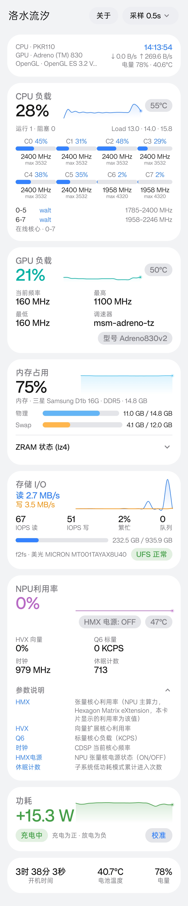

<div align="center">


# 洛水流汐 · Watch

**面向 Android 的本地系统监控工具**

在获得 Root 权限后，实时读取内核与厂商暴露的 `sysfs` / `debugfs` 节点，
展示 CPU、GPU、NPU、内存、换页与功耗状态。


[功能特性](#功能特性) · [界面预览](#界面预览) · [快速开始](#快速开始) · [数据来源](#数据来源) · [构建](#构建) · [常见问题](#常见问题) · [免责声明](#免责声明)

</div>

---

> [!IMPORTANT]
> 本应用需要 **Root 权限**。首次启动会进入授权拦截页，请在 Root 管理器中授权后点击「重试」。
> 建议在备用机或对数据无重要依赖的设备上使用。

## 界面预览

<p align="center">
  
</p>

## 功能特性

### CPU

- 总体负载 + 平滑趋势曲线
- 逐核负载与当前 / 最高频率
- cpufreq 频率簇、调速器与频率区间
- 在线核心、Load Average（1 / 5 / 15 分钟）
- 运行中 / 阻塞线程数
- SoC 温度（自动跳过读数为 0 的无效传感器）

### GPU

- 负载与趋势、当前 / 最高 / 最低运行频率
- 调速器（如 `msm-adreno-tz`）、GPU 温度与型号
- 多平台探测：高通 kgsl → MTK `gpufreqv2` → Mali / 三星 / PowerVR

### NPU

- HMX（张量核心）利用率与趋势
- HVX / Q6 / 核心时钟 / 休眠计数
- HMX 电源状态、NPU 温度、参数说明（可展开）

### 内存

- 物理内存与 Swap 进度
- ZRAM 压缩统计（算法 / 原始 / 压缩后 / 物理占用 / 压缩率）
- SWAP IO 读写量、拓展内存回写块
- 内存容量、类型（DDR5 等）、颗粒型号与制造商，来源 `/proc/devinfo/ddr`；设备未提供时显示「型号未暴露」

### 存储

- 实时读写速度（MB/s）与双色趋势图
- IOPS、I/O 繁忙度、队列深度
- 容量与占用、文件系统类型（f2fs / ext4）
- UFS 寿命估计、健康状态（正常 / 警告 / 紧急）
- 本次开机写入 / 读取、存储温度
- 点击卡片查看详细页（型号、制造商、健康、读写总量）

### 功耗

- 实时功耗（**充电为正、放电为负**）
- 充电 / 放电 / 已充满状态识别
- 手动校准：电流单位（自动 / µA / mA）、反转方向、0.5x - 2.0x 校准系数

### 其他

- 采样间隔可调：`0.1s / 0.2s / 0.5s / 1.0s / 2.0s / 5.0s`
- 常驻 Root Shell：`su` 只提权一次，后续采样复用同一 shell，减少进程创建与发热
- 顶栏「关于」查看版本信息与免责声明
- 厂商中英对照（如 MICRON → 美光、SK HYNIX → SK 海力士）
- MIUIX / HyperOS 风格界面，支持浅色与深色

## 快速开始

### 系统要求

| 项目 | 要求 |
|---|---|
| 系统版本 | Android 9（API 28）及以上 |
| 权限 | Root（Magisk / KernelSU / SukiSU 等） |
| 平台 | 主要面向高通骁龙设备（NPU / GPU 依赖高通节点） |

### 安装

1. 从 [Releases](../../releases) 下载最新 `app-debug.apk`；
2. 安装并打开；
3. 在 Root 管理器中给「洛水流汐」授权；
4. 回到应用点击「重试」，即可进入主界面。

> [!NOTE]
> 若无法通过系统安装器安装，可使用 `adb install -r app-debug.apk`。

### 从源码构建

```bash
git clone <your-repo-url>
cd watch
./build.sh              # 编译 release（R8 压缩，约 2 MB）并安装
./build.sh --no-install # 只编译
./build.sh --debug      # 编译 debug（速度快，体积大，含 Compose 工具）
```

release 产物：`app/build/outputs/apk/release/app-release.apk`
debug 产物：`app/build/outputs/apk/debug/app-debug.apk`

> release 包体积小是因为开启了 R8 代码压缩 + 资源裁剪；debug 包不做压缩，并且包含 `ui-tooling`，体积会大很多。

## 数据来源

所有数据均读取自系统公开节点，读取需要 Root。

| 指标 | 节点 |
|---|---|
| CPU 负载 | `/proc/stat`（总 cpu 行 + cpu0..N 行）两次采样差值 |
| 逐核频率 | `/sys/devices/system/cpu/cpu*/cpufreq/{scaling_cur_freq,cpuinfo_max_freq}` |
| 频率簇 / 调速器 | `/sys/devices/system/cpu/cpufreq/policy*/{related_cpus,scaling_governor,scaling_min_freq,scaling_max_freq}` |
| 在线核心 | `/sys/devices/system/cpu/online` |
| Load / 线程 | `/proc/loadavg`、`/proc/stat` 的 `procs_running` / `procs_blocked` |
| GPU 负载 | `/sys/class/kgsl/kgsl-3d0/gpu_busy_percentage`（无则 `gpubusy` 的 busy/total） |
| GPU 频率 / 温度 | `/sys/class/kgsl/kgsl-3d0/{gpuclk,devfreq/max_freq,devfreq/min_freq,devfreq/governor,temp,gpu_model}` |
| 内存 / Swap | `/proc/meminfo` |
| ZRAM | `/sys/block/zram0/*`，缺失时回退 `hybridswap_meminfo` |
| SWAP IO | `/proc/vmstat` 的 `pswpin` / `pswpout` |
| NPU | debugfs `sysmon_subsystem_stats/master_cdsp_stats` |
| 温度 | `/sys/class/thermal/thermal_zone*/{type,temp}` |
| 电池 / 功耗 | `/sys/class/power_supply/battery/{voltage_now,current_now,status,power_now,temp,capacity}` |
| 磁盘 I/O | `/proc/diskstats`（扇区 / 完成次数 / io_ticks 差值） |
| 磁盘容量 / 文件系统 | `/proc/mounts`、`stat -f /data` |
| 磁盘型号 / 厂商 | `/sys/block/sd*/device/{model,vendor}`，回退 `/proc/devinfo/ufs`、`/proc/scsi/scsi` |
| UFS 寿命 / 健康 | `/sys/devices/platform/soc/*/health_descriptor/{life_time_estimation_a,eol_info}` |
| 累计写入（合计） | 汇总所有 `/sys/fs/{f2fs,ext4}/*/lifetime_write_kbytes`（排除 loop 设备） |
| 本次开机写入 | `/proc/oplus_storage/io_metrics/forever/ufs_total_write_size_mb`（部分厂商） |
| 内存型号 / 厂商 | `/proc/devinfo/ddr`（类型 / 厂商 / Die / 容量），回退 `/proc/hwinfo`、`dmesg`、`ro.boot.ddr_*` |
| 网速 | `/proc/net/dev` 差值 |
| 开机时间 | `/proc/uptime` |

### 跨品牌探测顺序

按「厂商专有节点 → 标准接口 → 内核日志」短路探测，命中即停：

| 模块 | 探测顺序 |
|---|---|
| CPU 温度 | `thermal_zone` 匹配 `cpu` / `cpuss` / `soc` / `tsens` / `tj`，跳过 0 与 -273 |
| GPU | 高通 kgsl → MTK `/proc/gpufreqv2/gpufreq_status` → `/sys/kernel/gpu` → 三星 `gpusysfs` → Mali/Xclipse devfreq → PowerVR |
| NPU | 高通 debugfs `master_cdsp_stats` → `/sys/devices/virtual/npu/msm_npu/pwr`；MTK / 三星无公开统一端点，显示不支持 |
| RAM 颗粒 | `/proc/devinfo/ddr` → `/proc/hwinfo` → `dmesg` → `ro.boot.ddr_*` |
| ROM 颗粒 | `/sys/block/sd*/device/*` → `/proc/devinfo/ufs` → `/proc/scsi/scsi` → `/proc/hwinfo` → `dmesg` |
| ROM 健康 | `ufshcd/*/health_descriptor/life_time_estimation_a`（通配）→ `eol_info` / `pre_eol_info` |

任何节点缺失或无权限时静默降级，界面显示「—」，不阻塞采样。

## 项目结构

```
watch/
├── app/src/main/
│   ├── java/luolang/status/
│   │   ├── data/         数据模型
│   │   ├── monitor/      Root 检测、采集脚本、解析与采样循环
│   │   └── ui/           主界面、Root 拦截页、关于弹窗、主题与卡片
│   └── res/              图标与资源
├── docs/                 README 资源与截图
├── sign/                 本地签名文件（未入库）
├── build.sh              一键编译脚本
└── README.md
```

> 仓库不包含签名私钥。若本地不存在 `sign/LewoWoff.jks`，构建会自动回退到 Android 默认 debug 签名，clone 后可直接编译安装；需要固定签名时，自行把 keystore 放到 `sign/` 并同步修改 `app/build.gradle.kts`。

## 构建

| 工具 | 版本 |
|---|---|
| JDK | 17 |
| Gradle | 8.13 |
| Android Gradle Plugin | 8.9.0 |
| Kotlin | 2.0.21 |
| Compose BOM | 2025.09.00 |
| compileSdk / targetSdk | 35 / 35 |
| minSdk | 28 |

手动编译：

```bash
export JAVA_HOME=/path/to/jdk-17
export ANDROID_HOME=$HOME/Android/Sdk
cd watch
./gradle-8.13/bin/gradle assembleDebug --no-daemon
```

安装到设备：

```bash
adb install -r app/build/outputs/apk/debug/app-debug.apk
```

> [!WARNING]
> 本软件在 **Termux**（Android 上的 Linux 环境）中开发和编译，`build.sh` 依赖该环境的路径与工具链（JDK 17、Android SDK、`su` 安装等），**可能不适用于其他设备或构建环境**。在其他环境构建时，请按上方「手动编译」配置好 `JAVA_HOME` 与 `ANDROID_HOME` 后直接调用 Gradle。

## 常见问题

<details>
<summary><b>打开后一直停在「需要 Root 权限」？</b></summary>

本应用不会主动唤起 Root 管理器。请手动在 Magisk / KernelSU / SukiSU 中为「洛水流汐」授权，然后回到应用点击「重试」。
</details>

<details>
<summary><b>NPU 显示「不可用」？</b></summary>

NPU 数据依赖高通平台的 debugfs 节点 `sysmon_subsystem_stats/master_cdsp_stats`。非高通设备或内核未导出该节点时无法读取。
</details>

<details>
<summary><b>GPU 显示「不可用」？</b></summary>

GPU 数据依赖 kgsl 节点（`/sys/class/kgsl/kgsl-3d0`），仅高通 Adreno 设备支持。
</details>

<details>
<summary><b>ZRAM 数据全是 0？</b></summary>

部分厂商使用 hybridswap 实现「内存拓展」，标准 zram 节点不存在。应用会自动回退读取 `hybridswap_meminfo`。
</details>

<details>
<summary><b>功耗数值方向不对？</b></summary>

不同厂商 `current_now` 单位不统一（µA / mA），应用会做合理性校验；方向以电池 `status` 为准。
</details>

<details>
<summary><b>采样间隔不准？</b></summary>

单次采集约需 0.2s，因此 0.1s 档实际受采集耗时限制；其余档位会按设定值对齐。
</details>

## 更新日志

### v1.1.0

- 新增存储模块：读写速度 / IOPS / 繁忙度 / 队列 / 容量 / 文件系统 / UFS 健康 / 本次开机读写
- 新增内存颗粒信息：类型、制造商、型号
- 新增功耗手动校准（单位 / 方向 / 系数）
- 新增全品牌探测：GPU、NPU、RAM、ROM、温度
- 优化：`su` 只提权一次，采样复用常驻 root shell
- 优化：磁盘读写字号与排版，大速率不再换行

### v1.0.1

- 修复设备重启后 debugfs 未挂载导致 NPU 显示「不可用」
- 重建 v1.0.0 发布包

### v1.0.0

- 首个公开版本：CPU / GPU / NPU / 内存 / 功耗监控

## 免责声明

1. 本软件涉及 Root 权限和底层系统级操作。使用本软件造成的任何设备损坏（如变砖、死机、硬件烧毁）、数据丢失，均由使用者自行承担。
2. 作者不对任何因使用本软件引起的直接或间接损失负责。
3. 请务必在充分了解风险的情况下使用，建议在备用机上进行测试。

## 开源协议

本项目基于 [Apache License 2.0](https://www.apache.org/licenses/LICENSE-2.0) 开源。

## 作者

- **洛狼LewoWoff**
- QQ：1504273583
- E-Mail：lewowoff@foxmail.com
- GitHub：[@CatXiaoShi](https://github.com/CatXiaoShi)

---

<div align="center">

如果这个项目对你有帮助，欢迎点个 Star。

</div>
